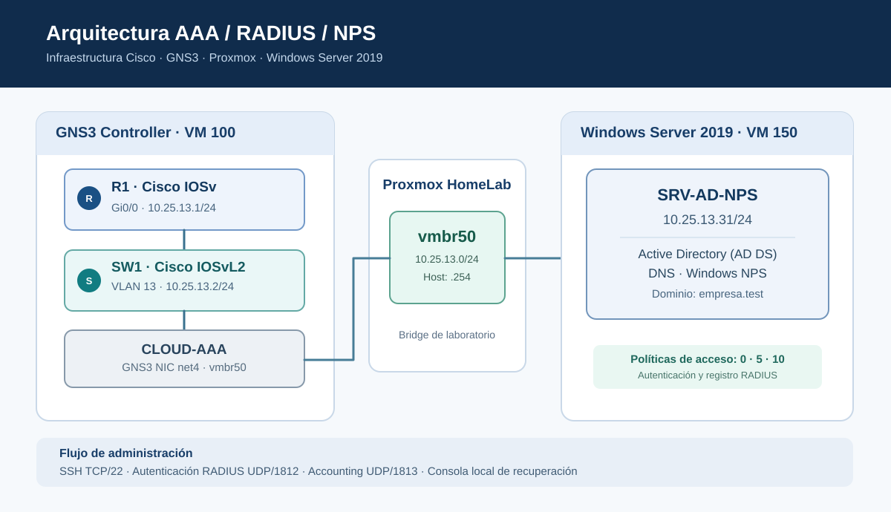
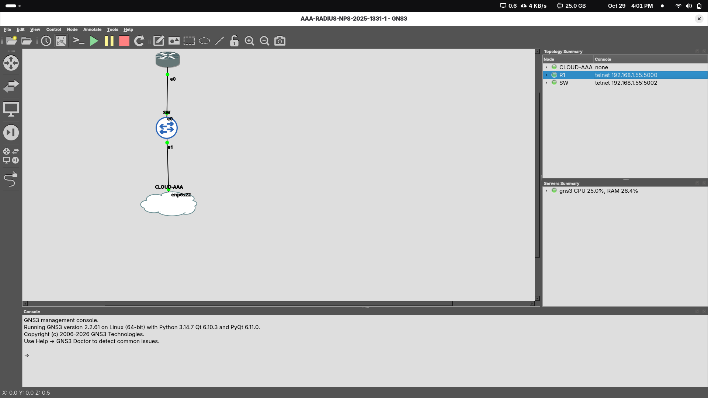

# Laboratorio AAA · RADIUS · Windows NPS

## 🎬 Video demostrativo — Práctica 4

**[▶ Ver demostración en YouTube](https://youtu.be/sHstTWs5tKY)** · [Enlace directo](https://youtu.be/sHstTWs5tKY)

Video grabado y enlace facilitado por el estudiante. La duración y los requisitos audiovisuales deben revisarse directamente en YouTube antes de la entrega.

---

**Autenticación, autorización y auditoría de acceso administrativo en equipos Cisco**

Proyecto académico de **Seguridad de Redes — ITLA**, implementado con Cisco IOSv/IOSvL2, GNS3, Proxmox, Windows Server 2019, Active Directory Domain Services (AD DS) y Network Policy Server (NPS).

| Proyecto | Responsable | Identificación | Fecha de validación |
|:--|:--|:--|:--|
| AAA / RADIUS / NPS | Elian Sterling Severino Mejía | Matrícula **2025-1331** | **29 de octubre de 2026** |

> **Resultado principal:** autenticación SSH centralizada, privilegios IOS 0/5/10 según políticas NPS, accounting de inicio y cierre de sesiones en ambos Cisco y autenticación local de recuperación por consola. Los resultados se documentan con configuraciones saneadas, registros y capturas auténticas.

## Navegación rápida

| Recurso | Contenido |
|:--|:--|
| [Arquitectura y direccionamiento](docs/02-topologia-y-red.md) | Equipos, VLAN, interfaces y flujos |
| [Implementación de AD DS y NPS](docs/03-active-directory-nps.md) | Usuarios, políticas y atributos Cisco |
| [Configuración AAA de Cisco](docs/04-cisco-aaa.md) | Autenticación, autorización, accounting y acceso de recuperación |
| [Pruebas y resultados](docs/05-pruebas-y-evidencias.md) | Matriz de verificación y limitaciones |
| [Galería de evidencias](docs/09-evidencias-visuales.md) | **21 capturas reales**, clasificadas, publicadas y enlazadas |
| [Conclusiones](docs/10-resultados-y-conclusiones.md) | Resultados, lecciones aprendidas y límites del laboratorio |
| [Video y entrega](docs/06-video-y-entrega.md) | Grabación y archivo TXT de la Práctica 4 |
| [Seguridad de los respaldos](docs/07-publicacion-y-seguridad.md) | Protección de secretos y alcance de publicación |

## Arquitectura implementada

| Elemento | Dirección | Función |
|:--|:--|:--|
| **R1** · Cisco IOSv | `10.25.13.1/24` · Gi0/0 | Router y cliente RADIUS |
| **SW1** · Cisco IOSvL2 | `10.25.13.2/24` · VLAN 13 | Switch y cliente RADIUS |
| **SRV-AD-NPS** · Windows Server 2019 | `10.25.13.31/24` | AD DS, DNS y servidor RADIUS/NPS |
| **Proxmox HomeLab** | `vmbr50` · `10.25.13.254/24` | Segmento virtual AAA |
| **GNS3 Controller** | VM 100 · interfaz net4 | Simulación Cisco y enlace a vmbr50 |

**Protocolos:** SSH sobre TCP/22, RADIUS Authentication sobre UDP/1812 y RADIUS Accounting sobre UDP/1813. La validación de credenciales y grupos se realiza en AD DS a través de NPS.

## Implementación AAA

| Función | Aplicación en R1 y SW1 | Comprobación |
|:--|:--|:--|
| **Authentication** | `LAB-RADIUS` en VTY 0–4 | Inicio de sesión por SSH utilizando cuentas de AD |
| **Authorization** | `LAB-EXEC` en VTY 0–4 | Niveles de privilegio recibidos mediante `Cisco-AV-Pair` |
| **Accounting** | `LAB-ACCOUNT` en VTY 0–4 | Registros RADIUS START y STOP |
| **Acceso de recuperación** | `LAB-LOCAL` en consola y AUX | Acceso local por consola probado con privilegio 15 |

Las políticas NPS **`AAA_NIVEL_0`**, **`AAA_NIVEL_5`** y **`AAA_NIVEL_10`** asignan el atributo `shell:priv-lvl` correspondiente. El valor de privilegio 0 se verificó por las restricciones del intérprete IOS; los niveles 5 y 10 se corroboraron con `show privilege`.

### Resultados comprobados

| Prueba | Evidencia obtenida | Resultado |
|:--|:--|:--|
| SSH a R1 con `usuario5` | `show privilege` = **5** | Confirmado |
| SSH a R1 con `usuario10` | `show privilege` = **10** | Confirmado |
| SSH a R1 con `usuario0` | Comandos limitados; `show privilege` no autorizado | Coherente con nivel 0 |
| SSH a SW1 con `usuario10` | `show privilege` = **10** | Confirmado |
| Accounting de R1 | **6 START + 6 STOP** en `IN261029.log` | Confirmado |
| Accounting de SW1 | **1 START + 1 STOP** en `IN261027.log` | Confirmado |
| Auditoría de NPS | Eventos **6272** y **6273** | Confirmado |
| Recuperación por consola | `adminrespaldo` y privilegio **15** | Confirmado |

El evento 6273 observado en NPS corresponde a un intento de `usuario0` rechazado por **Reason Code 16** (credenciales incorrectas). No representa indisponibilidad del servicio: se observaron autenticaciones posteriores exitosas.

### Evidencias visuales

Consulta el [**catálogo completo de 21 capturas**](docs/09-evidencias-visuales.md), que identifica su contenido y la fecha o fase de las pruebas. Las capturas de días anteriores se distinguen de las pruebas finales del 29 de octubre.

## Archivos técnicos

- [**Configuración saneada de R1**](configs/R1-running-sanitized.txt)
- [**Configuración saneada de SW1**](configs/SW1-running-sanitized.txt)
- [**Matriz de requisitos y pruebas**](docs/01-objetivos-rubrica.md)
- [**Plantilla de administración de identidades AD**](scripts/01-crear-grupos-usuarios-ad.ps1) — se conserva como **script de referencia**; no se afirma que toda la implementación haya sido ejecutada automáticamente desde este archivo.
- [**Bitácora histórica de implementación**](docs/08-estado-real.md)
- [**Archivo TXT de entrega — Práctica 4**](Elian_Sterling_Severino_Mejia_2025-1331_P4.txt)

Consulta también la [**política de publicación segura**](SECURITY.md).

Los archivos de configuración son **copias para documentación**, no restauraciones completas: se retiraron claves, hashes y banners extensos. El respaldo íntegro de NPS (`NPS-Backup.xml`) se conserva **fuera de GitHub** porque incluye secretos compartidos RADIUS sin cifrar.

## Alcance y consideraciones

- AUX está **configurada**, pero no se demostró una conexión auxiliar física en esta imagen virtual.
- SW1 conserva **VTY 5–15** con autenticación local predeterminada; RADIUS se aplica explícitamente a VTY 0–4.
- SW1 mantiene `ip http server` e `ip http secure-server` activos; en producción se revisaría su necesidad y exposición.
- RADIUS asigna niveles de sesión; **no se demuestra autorización granular por comando**, función habitualmente asociada a TACACS+.
- Se trata de una red de laboratorio, no de una configuración endurecida para producción.

## Documentación adicional

| Documento | Propósito |
|:--|:--|
| [01 · Requisitos](docs/01-objetivos-rubrica.md) | Alcance y estado real |
| [02 · Topología](docs/02-topologia-y-red.md) | Infraestructura y comunicaciones |
| [03 · Servidor](docs/03-active-directory-nps.md) | Usuarios, grupos y NPS |
| [04 · Dispositivos](docs/04-cisco-aaa.md) | Listas y líneas AAA |
| [05 · Verificación](docs/05-pruebas-y-evidencias.md) | Pruebas verificadas y evidencias complementarias |
| [06 · Video y entrega](docs/06-video-y-entrega.md) | Enlace de YouTube y comprobaciones de entrega |
| [07 · Publicación segura](docs/07-publicacion-y-seguridad.md) | Gestión de secretos |
| [08 · Bitácora histórica](docs/08-estado-real.md) | Registro cronológico; no refleja por sí solo el estado final |
| [09 · Galería visual](docs/09-evidencias-visuales.md) | Índice de capturas auténticas |
| [10 · Conclusiones](docs/10-resultados-y-conclusiones.md) | Resultados y aprendizaje |

---

**Elian Sterling Severino Mejía** · ITLA · Seguridad de Redes · Matrícula 2025-1331  
*Práctica académica documentada con evidencias reales. Video y entrega enlazados el 29 de octubre de 2026.*
